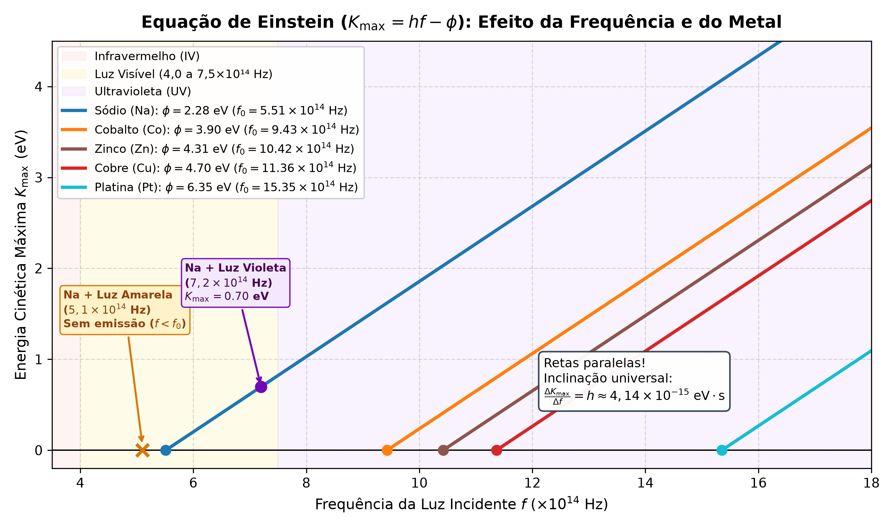
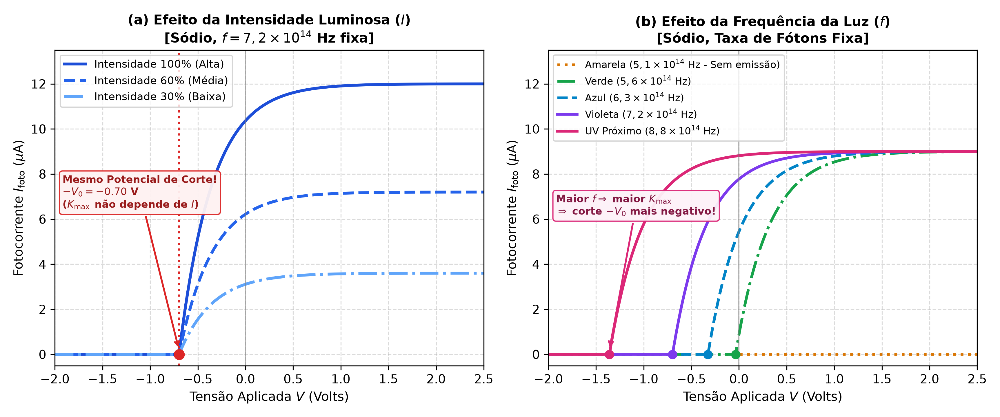
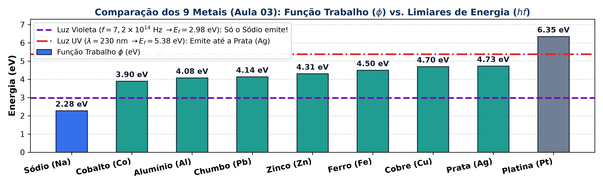
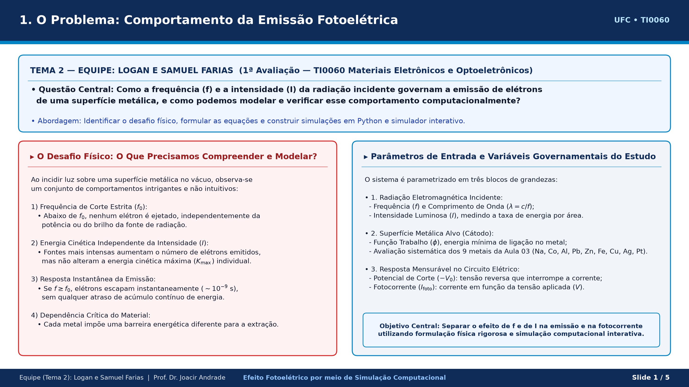
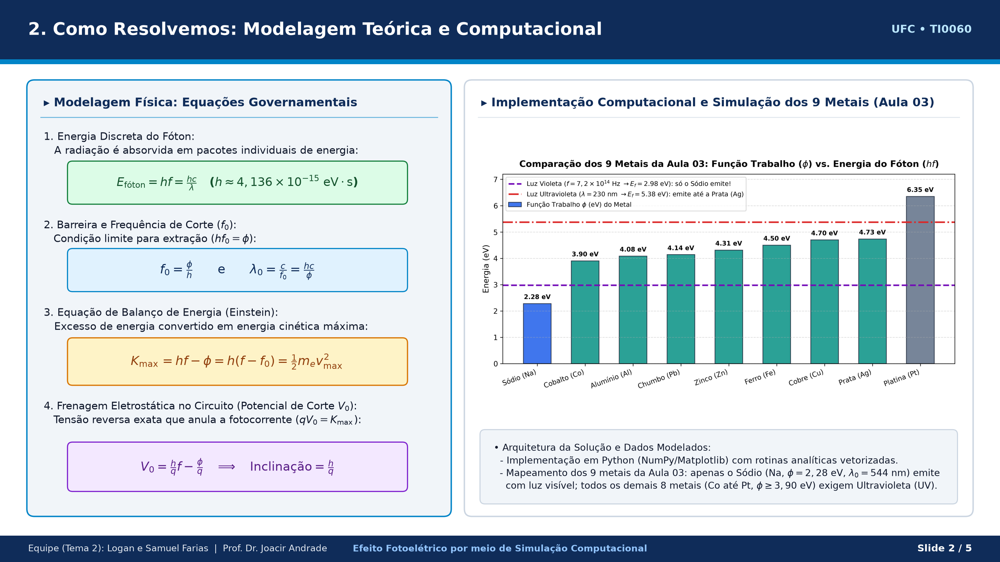
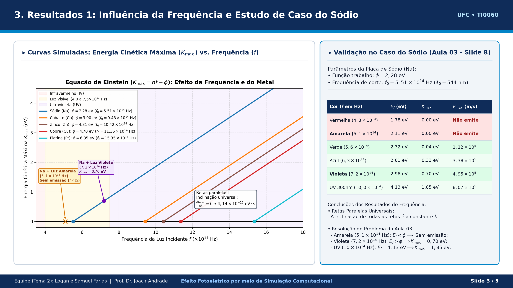
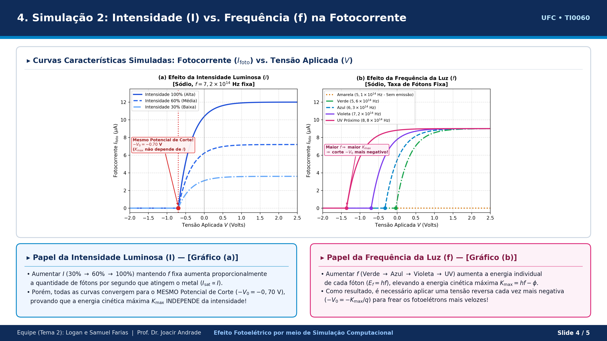
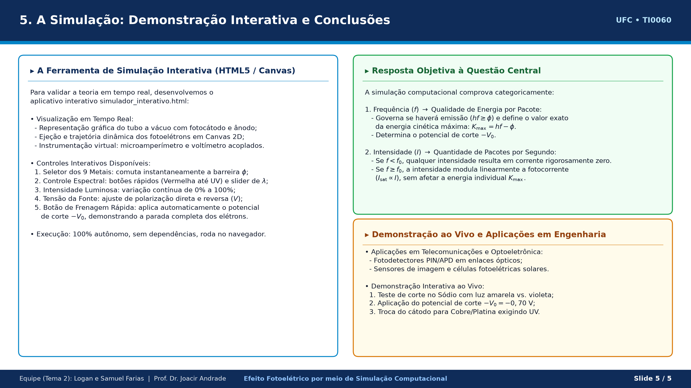

# ⚡ Efeito Fotoelétrico por meio de Simulação Computacional

> **Universidade Federal do Ceará (UFC) — Centro de Tecnologia**  
> **Curso:** Engenharia de Telecomunicações (Semestre 2026.2)  
> **Disciplina:** TI0060 — Materiais Eletrônicos e Optoeletrônicos  
> **Professor:** Dr. Joacir Andrade  
> **Avaliação:** 1ª Avaliação — **Tema 2 (Grupo 2)**  
> **Equipe:** Logan e Samuel Farias  

---

## 🎯 Sobre o Projeto

Este repositório reúne a **simulação computacional em Python**, o **simulador interativo em HTML5/Canvas**, os **gráficos científicos de alta resolução**, a **apresentação final (5 slides)** e o **guia de estudos/roteiro de apresentação** desenvolvidos para o **Tema 2** da 1ª Avaliação de *Materiais Eletrônicos e Optoeletrônicos*.

### Questão Central do Trabalho
> *"Como a frequência e a intensidade da luz incidente influenciam a emissão de elétrons de uma superfície metálica, e como a simulação permite verificar as previsões da teoria quântica da luz?"*

### Regras da Avaliação
- **Limite da Apresentação:** Máximo de **5 slides**.
- **Prazo de Envio Prévio:** Até **21/10/2026**.
- **Tempo de Exposição da Equipe:** Mínimo de **10 minutos** e máximo de **15 minutos**.

---

## 📂 Estrutura do Repositório

| Arquivo | Descrição |
| :--- | :--- |
| 📄 **[`Apresentacao_Tema02_Efeito_Fotoeletrico.pdf`](./Apresentacao_Tema02_Efeito_Fotoeletrico.pdf)** | **Apresentação final pronta (5 slides, formato 16:9)** para envio ao professor e projeção em sala. |
| ⚡ **[`simulador_interativo.html`](./simulador_interativo.html)** | **Simulador computacional interativo (HTML5/Canvas)**. Abre direto no navegador (offline) para demonstração ao vivo durante a apresentação. |
| 📘 **[`GUIA_ESTUDO_E_ROTEIRO_APRESENTACAO.md`](./GUIA_ESTUDO_E_ROTEIRO_APRESENTACAO.md)** | **Guia completo para a dupla**: explicação da física, roteiro de fala minuto a minuto dividido entre **Samuel e Logan** (12–13 min) e perguntas/respostas para a arguição. |
| 🐍 **[`simulacao_efeito_fotoeletrico.py`](./simulacao_efeito_fotoeletrico.py)** | Script Python (NumPy + Matplotlib) que modela a equação de Einstein, resolve os problemas da Aula 03 e exporta os gráficos em 300 DPI. |
| 🎨 **[`gerar_slides_pdf.py`](./gerar_slides_pdf.py)** | Script Python que compila os 5 slides diretamente para o arquivo PDF widescreen. |
| 📝 **[`Apresentacao_Tema02_Beamer.tex`](./Apresentacao_Tema02_Beamer.tex)** | Código-fonte alternativo dos 5 slides em **LaTeX Beamer** (compatível com Overleaf). |
| 📊 **[`fig1_kmax_vs_frequencia.png`](./fig1_kmax_vs_frequencia.png)** | Gráfico simulado: Energia Cinética Máxima ($K_{\max}$) vs. Frequência ($f$) para múltiplos metais. |
| 📊 **[`fig2_corrente_vs_tensao.png`](./fig2_corrente_vs_tensao.png)** | Painel duplo simulado: Fotocorrente ($I_{\text{foto}}$) vs. Tensão ($V$) variando Intensidade vs. Frequência. |
| 📊 **[`fig3_comparacao_metais_barreira.png`](./fig3_comparacao_metais_barreira.png)** | Comparativo das Funções Trabalho ($\phi$) dos 9 metais da Aula 03 frente à luz visível e UV. |

---

## 🚀 Como Usar (Guia Rápido para a Dupla)

### 1. Abrir o Simulador Interativo (Sem instalar nada)
Basta dar **duplo clique** no arquivo **[`simulador_interativo.html`](./simulador_interativo.html)** para abri-lo em qualquer navegador (Chrome, Edge, Firefox, Brave). Ele funciona **100% offline** e permite:
- Escolher qualquer um dos **9 metais da Aula 03** ($\text{Na}, \text{Co}, \text{Al}, \text{Pb}, \text{Zn}, \text{Fe}, \text{Cu}, \text{Ag}, \text{Pt}$);
- Variar a **Frequência ($f$)** / **Comprimento de onda ($\lambda$)** com botões rápidos para as cores da tabela do Prof. Joacir (*Vermelha, Amarela, Verde, Azul, Violeta e UV*);
- Variar a **Intensidade Luminosa ($I$)** de $0\%$ a $100\%$;
- Variar a **Tensão Coletor-Cátodo ($V$)** e clicar no botão **`🛑 Aplicar Potencial de Corte (-V₀)`** para ver os fotoelétrons sendo freados no tubo a vácuo em tempo real.

### 2. Executar os Scripts Python (Opcional — Para regerar gráficos e PDF)
Caso queiram modificar algum parâmetro ou regerar as imagens e o PDF:

```bash
# Instalar dependências (se necessário)
pip install numpy matplotlib reportlab

# 1. Rodar a simulação científica e gerar o relatório no terminal + 3 figuras PNG (300 DPI)
python simulacao_efeito_fotoeletrico.py

# 2. Regerar o PDF widescreen de 5 slides da apresentação
python gerar_slides_pdf.py
```

---

## 🔬 Síntese dos Resultados da Simulação (Alinhados à Aula 03)

### 1. Efeito da Frequência ($f$) e do Material ($\phi$) — Equação de Einstein
Pela teoria quântica de Planck-Einstein, a luz é composta por fótons de energia $E_f = hf$. A emissão só ocorre se $hf \ge \phi$ ($f \ge f_0 = \phi/h$), resultando na energia cinética máxima:

$$K_{\max} = h f - \phi = h(f - f_0)$$



### 2. Efeito da Intensidade ($I$) vs. Frequência ($f$) na Fotocorrente ($I_{\text{foto}} \times V$)
- **Variando a Intensidade ($f$ fixa):** Aumenta o número de fótons por segundo e, consequentemente, a fotocorrente de saturação ($I_{\text{sat}} \propto I$), mas **não altera o potencial de corte $-V_0$ nem $K_{\max}$**.
- **Variando a Frequência (taxa de fótons fixa):** Aumenta a energia individual de cada fóton ($hf$), elevando $K_{\max}$ e deslocando o potencial de corte $-V_0$ para valores mais negativos.



### 3. Comparação dos 9 Metais da Aula 03 (Slide 8)
Simulação das funções trabalho tabeladas na Aula 03 do Prof. Joacir Andrade, demonstrando por que apenas o **Sódio ($\text{Na}$, $\phi = 2{,}28\text{ eV}$)** apresenta emissão na faixa da luz visível, enquanto os demais metais exigem radiação **Ultravioleta (UV)**:



| Metal | Função Trabalho $\phi$ ($\text{eV}$) | Frequência de Corte $f_0$ ($\times 10^{14}\text{ Hz}$) | Comprimento Limiar $\lambda_0$ ($\text{nm}$) | Região Espectral de Corte |
| :--- | :---: | :---: | :---: | :---: |
| **Sódio ($\text{Na}$)** | $2{,}28$ | $5{,}51$ | $543{,}8$ | Luz Visível (Verde) |
| **Cobalto ($\text{Co}$)** | $3{,}90$ | $9{,}43$ | $317{,}9$ | Ultravioleta (UV) |
| **Alumínio ($\text{Al}$)** | $4{,}08$ | $9{,}87$ | $303{,}9$ | Ultravioleta (UV) |
| **Chumbo ($\text{Pb}$)** | $4{,}14$ | $10{,}01$ | $299{,}5$ | Ultravioleta (UV) |
| **Zinco ($\text{Zn}$)** | $4{,}31$ | $10{,}42$ | $287{,}7$ | Ultravioleta (UV) |
| **Ferro ($\text{Fe}$)** | $4{,}50$ | $10{,}88$ | $275{,}5$ | Ultravioleta (UV) |
| **Cobre ($\text{Cu}$)** | $4{,}70$ | $11{,}36$ | $263{,}8$ | Ultravioleta (UV) |
| **Prata ($\text{Ag}$)** | $4{,}73$ | $11{,}44$ | $262{,}1$ | Ultravioleta (UV) |
| **Platina ($\text{Pt}$)** | $6{,}35$ | $15{,}35$ | $195{,}3$ | Ultravioleta (UV) |

---

## 🎤 Divisão Sugerida para a Apresentação (10 a 15 min)

O roteiro detalhado das falas e a demonstração ao vivo estão em **[`GUIA_ESTUDO_E_ROTEIRO_APRESENTACAO.md`](./GUIA_ESTUDO_E_ROTEIRO_APRESENTACAO.md)**:

1. **Slide 1 e Slide 2 (~4 min — Samuel Farias):** Questão central, falha da física clássica vs. solução quântica de Planck-Einstein ($E = hf$), função trabalho ($\phi$), frequência de corte ($f_0$) e análise dos 9 metais da Aula 03.
2. **Slide 3 e Slide 4 (~4,5 min — Logan):** Análise das curvas simuladas $K_{\max} \times f$ (inclinação universal $h$), resolução do estudo de caso do Sódio (Luz Amarela vs. Violeta vs. UV) e comparação entre Intensidade e Frequência nas curvas $I_{\text{foto}} \times V$.
3. **Slide 5 + Simulador Interativo ao Vivo (~3,5 min — Samuel + Logan):** Demonstração em tempo real no `simulador_interativo.html` (testando corte quântico, potencial de frenagem $-V_0$ e troca de metal) e síntese final respondendo à Questão Central.

---

## 🖼️ Prévia Visual dos 5 Slides ([`Apresentacao_Tema02_Efeito_Fotoeletrico.pdf`](./Apresentacao_Tema02_Efeito_Fotoeletrico.pdf))

### Slide 1 — Questão Central e Ruptura Quântica


### Slide 2 — Modelagem Física e os 9 Metais da Aula 03


### Slide 3 — Simulação 1: Efeito da Frequência ($K_{\max} \times f$) e Caso do Sódio


### Slide 4 — Simulação 2: Intensidade vs. Frequência na Fotocorrente ($I_{\text{foto}} \times V$)


### Slide 5 — Resposta à Questão Central e Conclusões


# Trabalho-Materiais

